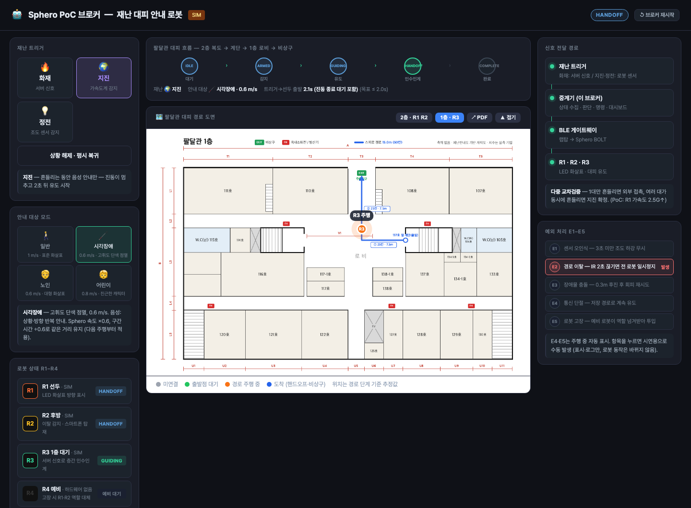
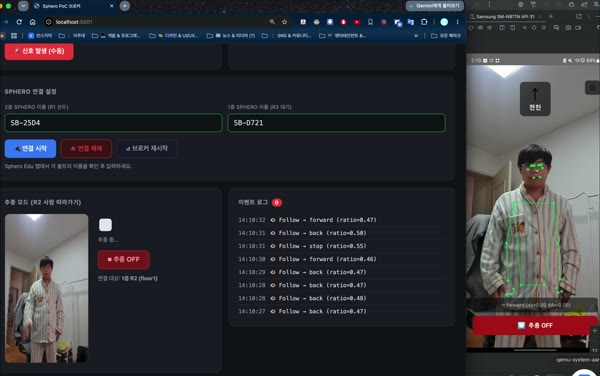
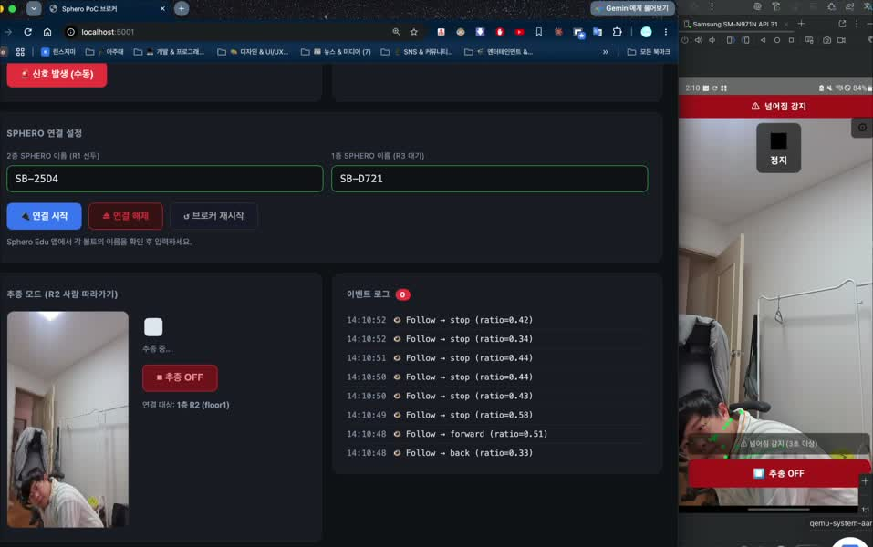
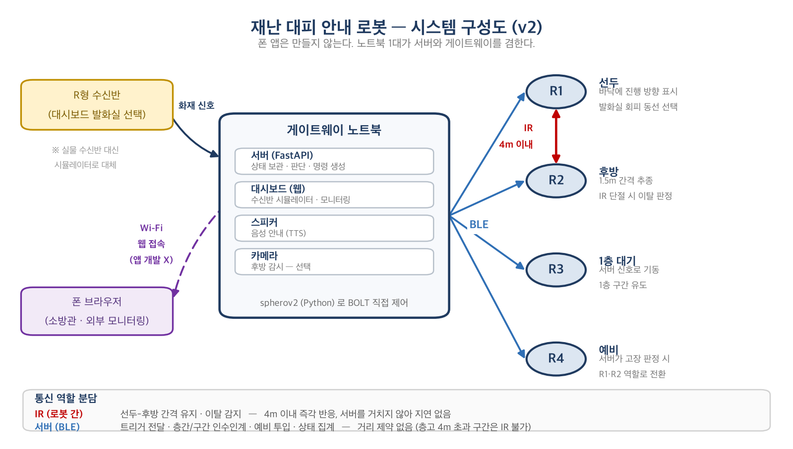
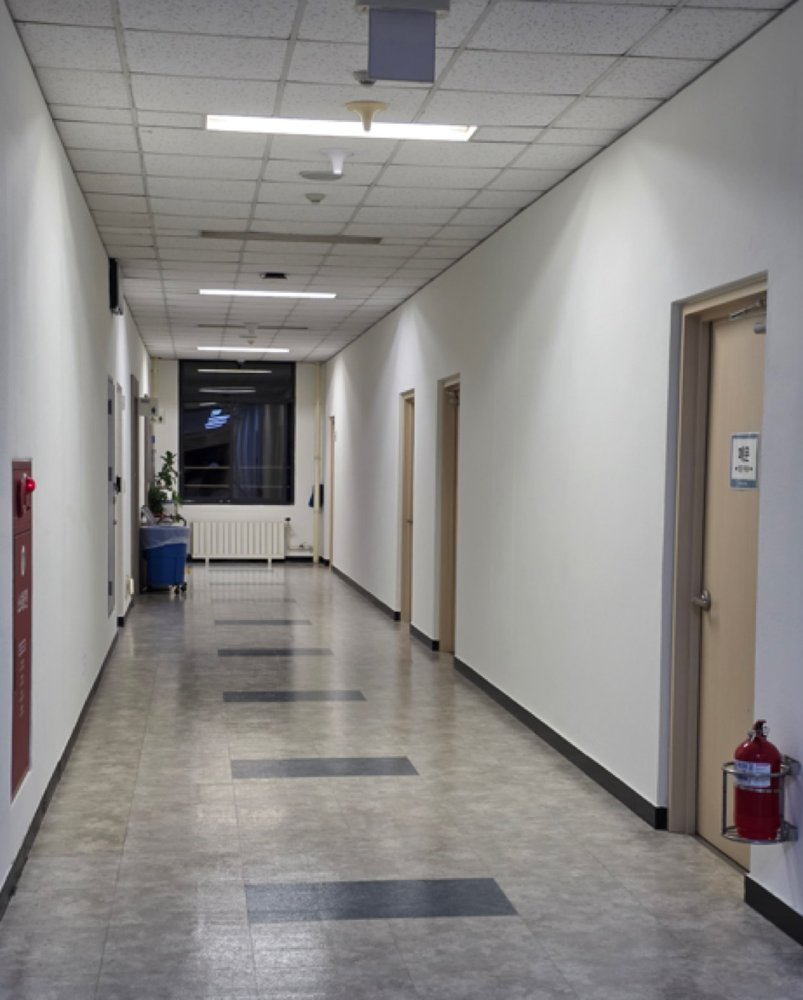
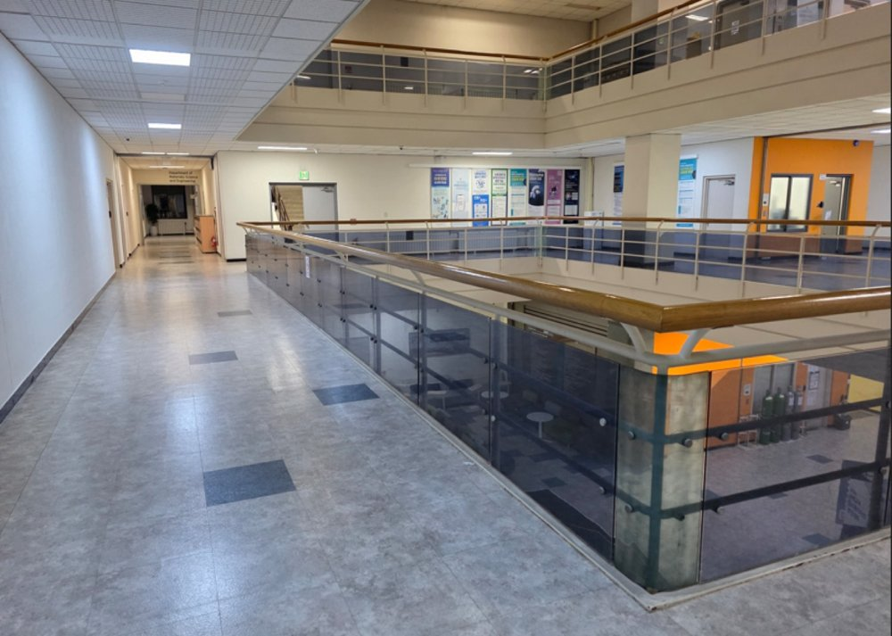
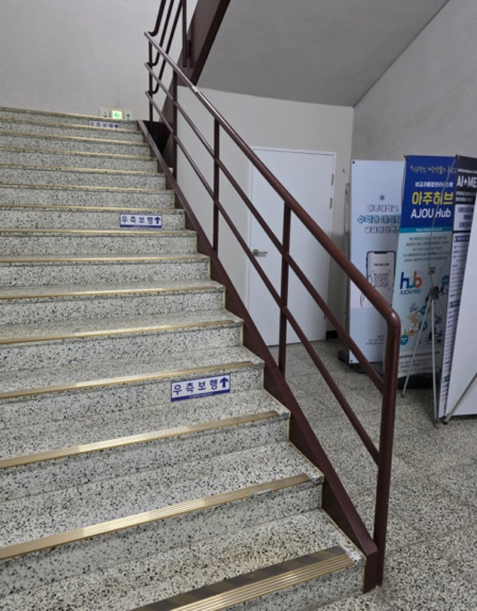
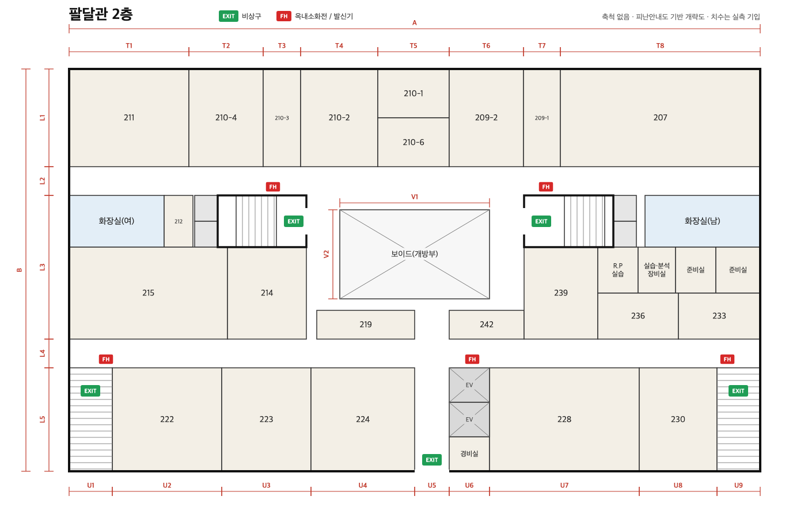
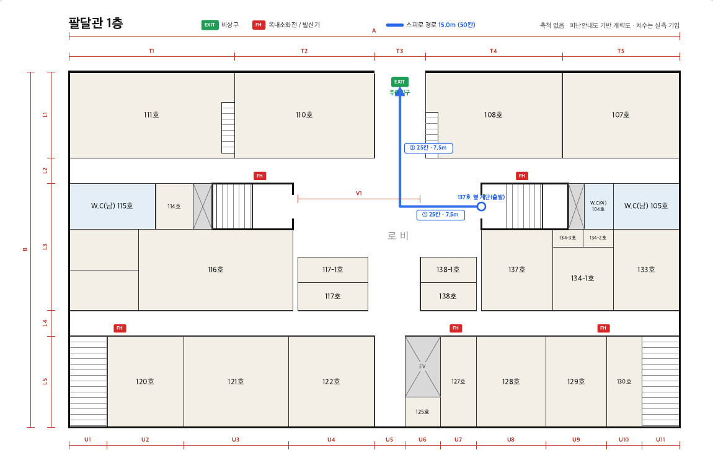

<p align="center"></p>

# 반디 (BANDI) — Sphero 재난 대피 안내 로봇 브로커

ISE103 융합시스템창의설계 팀 프로젝트 (4조 잇다 ITDA).
**반디**는 반딧불이처럼 빛나는 공 로봇이 어둠 속에서 앞서가며 비상구로 길을 안내한다는 뜻이다.
Sphero BOLT 로봇(R1·R2·R3)과 Android 앱을 연결하는 Flask 브로커 서버와 웹 대시보드.
팔달관 2층 복도 → 계단 → 1층 로비 → 비상구로 대피자를 안내한다.


## 대시보드

| 지진 · 시각장애 모드 · 1층 인수인계 | 전체 화면 (대피 완료) |
|---|---|
|  |  |

- **대피 흐름 타임라인**: IDLE → ARMED → GUIDING → HANDOFF → COMPLETE. 실제 주행 진행에 맞춰 바뀐다.
- **재난 트리거**: 화재(서버 신호) · 지진(가속도계) · 정전(조도 센서) · 상황 해제. 키보드 `1` `2` `3` `0`.
  - 지진은 진동이 멈추고 2초 뒤 유도를 시작한다. R1을 2.5G 이상 흔들어도 지진으로 처리한다.
  - 상황 해제를 누르면 주행 중인 로봇이 바로 멈춘다.
- **안내 대상 모드**: 일반 1.0 · 시각장애 0.6 · 노인 0.6 · 어린이 0.8 m/s.
  Sphero 속도를 비율만큼 낮추고 구간 시간을 늘려 같은 거리를 간다.
- **로봇 상태 R1–R4**: 로봇별 단계와 연결 상태. R4(예비)는 하드웨어 없이 표시만 한다.
- **팔달관 도면 위 로봇 위치**: 1·2층 도면의 스피로 경로 위에 R1·R2·R3 위치를 표시한다.
  위치는 경로 단계로 추정한 값이다. 주행 중인 층의 탭으로 자동 전환된다.
- **신호 전달 경로**: 재난 트리거 → 중계기 → BLE 게이트웨이 → 로봇. 정전 때는 네트워크가 끊긴 상태로 표시한다.
- **예외 처리 E1–E5**: E4(명령 실패)·E5(로봇 미연결)는 주행 중 자동 표시. 나머지는 눌러서 시연용으로 발생시킨다(표시·로그만).
- **R2 카메라 감지**: Android 앱이 보낸 대피자 움직임·넘어짐을 표시한다. 넘어짐이 확정되면 상단 빨간 경보 바, 카메라 빨간 테두리, 도면의 R2 마커로 알린다.

## R2 카메라 추적 (Android 앱 연동)

R2 트롤리에 실은 스마트폰 앱([itda-spherocam](https://github.com/SODA1127/itda-spherocam))이 ML Kit Pose Detection으로 대피자를 추적한다.
앱은 방향(`/api/follow/direction`)과 JPEG 프리뷰(`/api/follow/preview`)를 브로커로 보내고, 대시보드에 카메라 화면과 감지 결과가 표시된다.
(아래는 초기 추종 모드 화면. 지금 브로커는 카메라 감지를 기록·표시만 하고, R2 주행은 R1 경로를 따른다.)

| 장면 | 화면 | 감지 기준 |
|:---:|:---:|:---|
| **전진** |  | 사람이 카메라에서 멀어짐 → 면적 감소 → `forward` |
| **후진** |  | 사람이 너무 가까이 접근 → 면적 비율 초과 → `back` |
| **좌회전** |  | 사람이 화면 왼쪽으로 이동 → X 중심 감소 → `left` |
| **우회전** |  | 사람이 화면 오른쪽으로 이동 → X 중심 증가 → `right` |
| **정지** |  | 면적 변화 없이 정면 위치 → `stop` |
| **넘어짐 감지** |  | 사람 박스 가로/세로(화면 픽셀) > 1.0 또는 상체 기울기 > 60°가 3초 지속 → ⚠ 넘어짐 경고, 대시보드·로그에 표시 |

## 시스템 구성

게이트웨이 노트북 1대가 서버·대시보드와 BLE 게이트웨이를 맡는다. 로봇 간 간격 유지는 IR, 트리거 전달·층간 인수인계는 서버(BLE)가 담당한다.



## 전체 동작 순서도

IDLE → ARMED → GUIDING → HANDOFF → COMPLETE 흐름과 예외 처리 E2–E5 분기.


## 시연 장소 — 팔달관

2층 복도 → 계단실 → 1층 로비 → 비상구 경로. 층별 도면은 `팔달관_도면.pdf`.

| 2층 복도 | 2층 난간 (유리막) | 계단실 | 계단실 (층간) |
|---|---|---|---|
|  |  |  |  |

| 팔달관 2층 도면 (스피로 경로) | 팔달관 1층 도면 (스피로 경로) |
|---|---|
|  |  |

## 구성

| 파일 | 설명 |
|------|------|
| `sphero_broker.py` | 실행 파일 (`bandi.app.main` 호출) |
| `bandi/` | 브로커 파이썬 패키지 — 아래 코드 구조 참고 |
| `frontend/` | 대시보드 화면 — `templates/index.html`, `static/css`, `static/js` |
| `cloudflare/` | 외부 접속 Worker(`bandi`)와 터널 실행 스크립트 |
| `floorplan_1f.png`, `floorplan_2f.png` | 대시보드용 팔달관 1·2층 도면 |
| `brand/` | BANDI 로고(투명 배경) · 심볼 · 파비콘 |
| `팔달관_도면.pdf`, `팔달관_도면.html` | 층별 도면 원본 (실측 기입용) |
| `재난대피로봇_시연/index.html` | 단독 시연 페이지 (서버 없이 애니메이션만) |
| `동작 알고리즘 개선안 v2.md` | 알고리즘 설계 문서 |
| `Sphero 제약 시트.md` | Sphero BOLT 제약사항 정리 |

### 코드 구조

| 모듈 | 내용 |
|------|------|
| `bandi/config.py` | 로봇 이름·포트·대피 경로·주행 기본값·안내 대상 모드·재난·예외 정의, 설정 파일 읽기 |
| `bandi/state.py` | 대시보드 공유 상태 `state`, 런타임 값 `rt`(연결된 BOLT·주행 세대 등), 이벤트 로그·예외 표시, 설정 저장 |
| `bandi/hw.py` | 로봇 입출력 — LED·매트릭스, 주행 명령, 위치 센서 읽기·좌표 변환, 시뮬레이션 |
| `bandi/nav.py` | 위치 기반 주행·좌표축 보정·평시 복귀(R2 U턴) |
| `bandi/follow.py` | R2가 R1 발자국 따라가기, 모서리 정지, IR 끊김·경로 이탈 감시 |
| `bandi/manual.py` | R2 수동 조작(원격) 진입·해제, 폰 음성 안내(TTS) 큐 |
| `bandi/scenario.py` | 재난 신호 처리, 2층→1층 인수인계, 테스트 경로 |
| `bandi/aim.py` | 방향 보정 — 수동 에임, 나침반 자동 에임 |
| `bandi/camera.py` | R2 카메라 앱 감지 상태(넘어짐·시야 이탈), 프리뷰 프레임 |
| `bandi/ble.py` | Sphero BLE 연결·센서 스트리밍·하트비트, R1 흔들기(지진) 감지 |
| `bandi/web/` | Flask 앱 조립(`server.py`), 외부 접속 보호(`auth.py`)와 Blueprint — `pages`, `api_system`, `api_robot`, `api_manual`, `api_camera` |
| `bandi/app.py` | 진입점 — 로그 설정, BLE·감시 스레드 시작, 웹 서버 실행 |

의존 방향: `config → state → hw → nav → manual → follow → scenario → ble → web` (아래 모듈이 위 모듈을 가져다 씀, 순환 없음).
대시보드 JS는 `window.BANDI`(서버 설정값)를 받아 `frontend/static/js/*.js`를 순서대로 불러온다.

## 실행 방법

```bash
# 의존성 설치
pip3.9 install flask flask-sock spherov2

# 실제 BLE 연결 (포트 5001)
python3.9 sphero_broker.py

# Sphero 없이 시뮬레이션 — R1·R2·R3 모두 가상 주행
python3.9 sphero_broker.py --sim

# 포트 변경
python3.9 sphero_broker.py --sim --port 5002
```

대시보드: http://localhost:5001

## 외부 접속 (Cloudflare)

같은 와이파이 밖에서는 **https://bandi.dlrlwjd1127.workers.dev** 로 대시보드를 본다.

```
브라우저 → Worker bandi (cloudflare/) → Workers VPC 서비스 bandi-broker → 터널 bandi → 맥의 브로커 127.0.0.1:5002
```

- 터널에 공개 주소가 없어서 Worker를 거쳐야만 들어온다. Worker가 `X-Bandi-Remote: 1`을 붙이고, 브로커는 이 요청을 외부로 본다.
- 외부는 **보기 전용** — 상단 바에 원격 조작 비밀번호를 넣으면 7일간 조작 가능. 비밀번호는 `BANDI_REMOTE_PASSWORD` 환경 변수 또는 저장소 루트 `remote_password.txt` (git 제외). 없으면 보기만.
- 틀린 비밀번호는 IP당 1분 5회까지. 외부 화면은 요청 수를 줄이려 2초마다 갱신 (Workers 무료 한도 하루 10만 건).
- 같은 와이파이의 폰 앱·대시보드는 지금처럼 모두 가능.

```bash
./cloudflare/run-tunnel.sh                 # 터널 켜기 (브로커와 함께)
cd cloudflare && npx wrangler deploy       # Worker 수정 뒤 배포
```

## 주행 흐름

1. 재난 신호 수신 → **ARMED** (화재·지진·정전 모두 같은 경로. 지진은 진동이 멈추고 2초 뒤 출발)
2. 2층 → **GUIDING**
   - **R1(선두)**: 경로(`ROUTE_2F_M`, 지금은 직진 5.7m → 좌회전 9.0m)를 **위치 센서 기반**으로 주행
   - **R2(후방)**: R1이 실제로 지나간 좌표(발자국)를 **경로 거리로 간격만큼 뒤에서** 따라간다. R1이 꺾은 자리에서 똑같이 꺾고, R1이 도착하면 도착 간격(최대 1m)까지 다가가 선다
   - 꺾기 전 1초 정지하고 매트릭스에 꺾는 방향(`<` `>`)을 보여 준다
3. R1이 계단 앞에 도착하면 중계기가 R3에 출발 명령 → **HANDOFF**
4. R3이 1층 경로(`ROUTE_1F_M`)로 비상구까지 유도 → **COMPLETE**

### 위치 센서(locator) 기반 주행

- BOLT가 0.1초마다 보내는 자기 위치(cm, x = 오른쪽 / y = 앞)를 보며 각 구간의 **목표 좌표**까지 보정하며 간다 (±25°, 30cm 안에서 감속, 4cm 앞에서 정지)
- 연결·에임 때 위치 원점을 리셋하고, 첫 15cm 주행으로 위치 좌표축 회전을 자동 추정
- 위치가 안 오면 자동으로 시간 기반 주행으로 바꿈 (구간 시간 = 거리 ÷ (`DRIVE_MPS` × 속도/100))
- 공통 좌표: R2 출발점 기준. **R1·R2를 같은 방향으로 에임하고, R1을 간격만큼 앞에 일직선으로** 놓는다

### 평시 복귀 (상황 해제)

- 각 로봇이 지나온 꺾임점을 거꾸로 거쳐 **출발 좌표로** 돌아가 원래 방향(0°)으로 선다
- R2가 먼저 돌아가고, R1은 R2와 거리를 지키며 뒤따른다
- R2(트롤리)는 끝에서 움직이며 반원 **U턴**해 트롤리까지 원래 방향으로. U턴이 옆으로 옮기는 거리를 미리 비켜서 보정하고, 실제로 옮긴 거리를 재서 다음 복귀에 반영
- 로봇이 주행·복귀하는 동안과 멈춘 뒤 3초는 흔들기를 지진으로 보지 않음 (자기 움직임 오감지 방지)

### 🧪 테스트 경로

재난 트리거 카드의 테스트 버튼 — R1 직진 1m → 좌회전 1.5m, R2는 같은 방식으로 R1을 따라감 (R3는 혼자 ㄱ자). 상황 해제로 출발점 복귀.
ㄱ자 회전 검증은 간격을 50cm 정도로 짧게 (간격이 1m 이상이면 R2는 모서리 전에 멈춤).

### 🎮 R2 경로 이탈 폴백 — 수동 조작(원격)

R2가 따라가다 R1을 놓치면 자동 주행을 멈추고 대시보드 수동 조작으로 넘긴다 (예외 E2).

- **IR 끊김** — R1이 IR을 송출하고 R2가 IR 수신기로 읽는다. 2초 동안 R1이 안 잡히면 전환. 따라가기 시작 후 5초 안에 한 번도 안 잡히면 IR 감지는 끄고 위치 감시만 (BOLT IR 거리 약 3m)
- **경로 이탈** — R2가 R1 발자국에서 40cm 넘게 1초 이상 벗어나면 전환
- 전환되면 R2 정지 · 매트릭스 보라색 `?` · 폰이 "안내 로봇과 연결이 끊겼습니다…" 음성 안내
- **R2 카드 → 🎮 수동 조작** 패널: WASD(키보드·버튼, 누르는 동안 이동, 0.5초 신호 끊기면 정지) · 매트릭스 표시(↑ ← → ↓ ✕ ! ? 끔) · 폰 음성 안내 입력
- **📡 IR 끊김 테스트** 버튼으로 실제 끊김 없이 시연

### 주행 설정 (대시보드 "주행 속도" 카드 · `speed_settings.json`에 저장)

| 항목 | 기본값 | 설명 |
|---|---|---|
| R1 / R2 / R3 속도 | 100 / 150 / 100 | 1~255. 각자 자기 속도로 정해진 거리만큼 간다. 권장: R2는 R1보다 조금 높게 (트롤리) |
| 전방–후방 간격 | 400cm | 10~1420cm. R1이 R2보다 이만큼 앞에서 출발 |
| R2 출발 지연 | 0초 | 0이면 R1과 동시 출발 |
| 꺾기 전 정지 | 1초 | 방향이 바뀌는 지점에서 멈춤 |
| R2 거리 보정 | 100% | R2가 트롤리 때문에 바퀴가 미끄러져 덜 가면 올림 — 위치 센서 거리를 이 비율로 나눠 실제 거리로 봄 (시간 기반 주행은 시간을 늘림) |

### 방향 보정 — 기준: R2 스마트폰 셀피 정면 = 0°

- **🧭 나침반 자동 에임**: 앱이 보낸 셀피 정면 방위로 각 로봇이 북쪽을 찾은 뒤 그 방향을 0°로 저장 (`/api/aim/auto`)
- **수동 미세 조정**: 보정 시작 → ⟲/⟳ 1°·5°·15° → 0°로 저장. 자동 에임 뒤 조정한 각도는 로봇별 보정값으로 기억해 다음 자동 에임에 더한다

## API 엔드포인트

| 메서드 | 경로 | 설명 |
|--------|------|------|
| `GET` | `/` | 웹 대시보드 |
| `GET` | `/api/status` | 연결·배터리·경로·대피 단계·예외 상태 |
| `POST` | `/api/connect` | BLE 연결 시작 |
| `POST` | `/api/disconnect` | BLE 연결 해제 |
| `POST` | `/api/restart` | 브로커 재시작 |
| `POST` | `/api/trigger` | 대피 경로 주행 시작 (화재) |
| `POST` | `/api/disaster` | `{"type": "fire"\|"quake"\|"black"\|"clear"}` 재난 발생·해제 |
| `POST` | `/api/target` | `{"mode": "normal"\|"blind"\|"elder"\|"child"}` 안내 대상 모드 |
| `POST` | `/api/exception` | `{"id": "E1".."E5"}` 예외 수동 발생 |
| `POST` | `/api/reset` | 상태 초기화 (주행 중단) |
| `GET` | `/floorplan` | 층별 도면 PDF |
| `GET` | `/floorplan-img/<1f\|2f>` | 층별 도면 PNG |
| `POST` | `/api/follow/toggle` | R2 카메라 감지 ON/OFF |
| `POST` | `/api/follow/direction` | 카메라 방향·넘어짐 수신 |
| `POST` | `/api/follow/preview` | JPEG 프리뷰 수신 |
| `POST` | `/api/follow/calibrate` | R2 heading 0° 리셋 |
| `POST` | `/api/speeds` | 주행 속도·R2 지연·꺾기 정지·R2 거리 보정 설정 |
| `POST` | `/api/aim` | `{"robot", "action": "start"\|"rotate"\|"set"\|"clear_trim", "delta"}` 수동 방향 보정 |
| `POST` | `/api/aim/auto` | 나침반 자동 에임 (연결된 로봇 전부) |
| `POST` | `/api/phone/heading` | 앱의 셀피 정면 방위 수신 |
| `POST` | `/api/test_route` | 테스트 경로 (ㄱ자 1m·1.5m) |
| `POST` | `/api/manual` | `{"on": bool, "sim"?: bool}` R2 수동 조작 켜기·끄기 (sim = IR 끊김 테스트) |
| `POST` | `/api/manual/drive` | `{"cmd": "w"\|"a"\|"s"\|"d"\|"stop"}` R2 수동 주행 |
| `POST` | `/api/manual/matrix` | `{"pattern": "up"\|"left"\|"right"\|"down"\|"stop"\|"warn"\|"help"\|"off"}` R2 매트릭스 |
| `POST` | `/api/manual/tts` | `{"text"}` R2 폰 음성 안내 (폰은 `/api/phone/heading` 응답으로 받음) |
