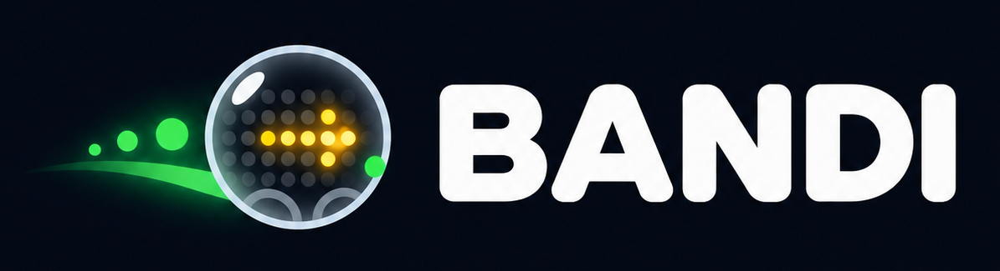
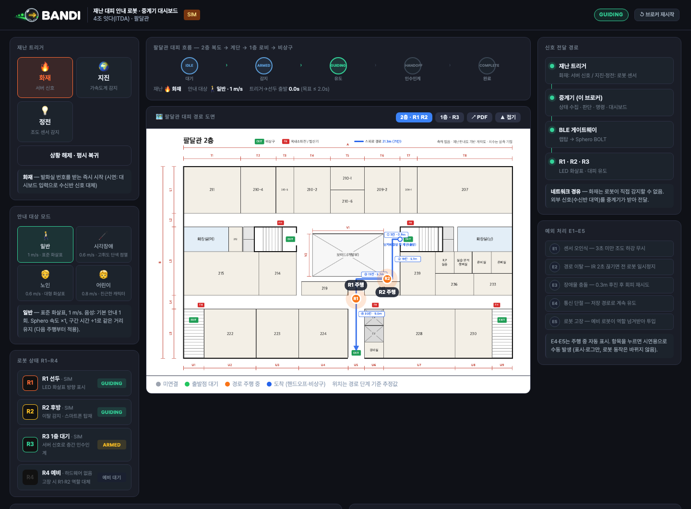
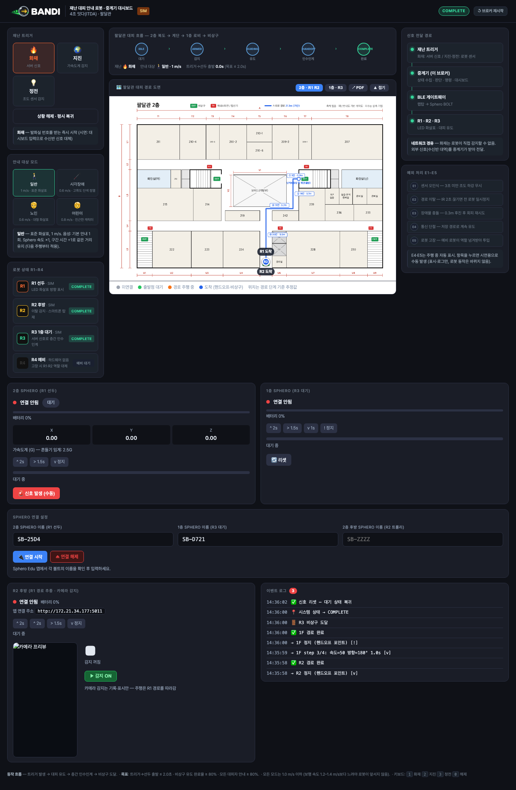
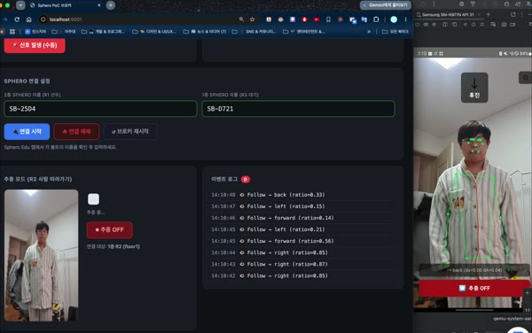
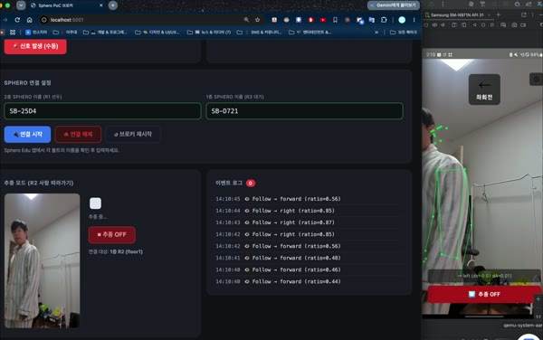
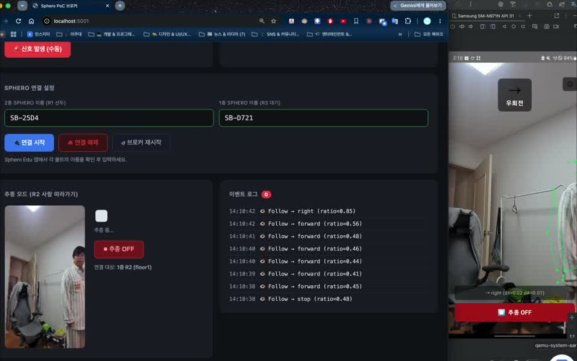
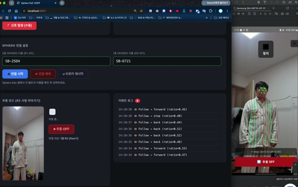
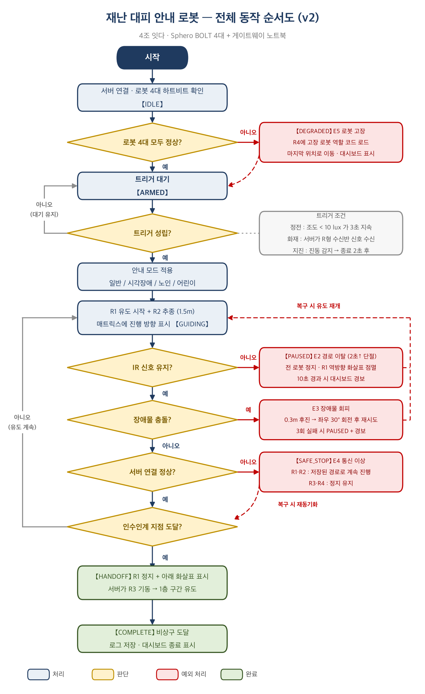
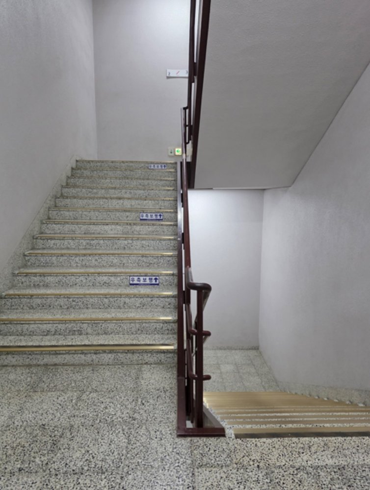

<p align="center"></p>

# 반디 (BANDI) — Sphero 재난 대피 안내 로봇 브로커

ISE103 융합시스템창의설계 팀 프로젝트 (4조 잇다 ITDA).
**반디**는 반딧불이처럼 빛나는 공 로봇이 어둠 속에서 앞서가며 비상구로 길을 안내한다는 뜻이다.
Sphero BOLT 로봇(R1·R2·R3)과 Android 앱을 연결하는 Flask 브로커 서버와 웹 대시보드.
팔달관 2층 복도 → 계단 → 1층 로비 → 비상구로 대피자를 안내한다.



## 대시보드

| 지진 · 시각장애 모드 · 1층 인수인계 | 전체 화면 (대피 완료) |
|---|---|
|  |  |

- **대피 흐름 타임라인**: IDLE → ARMED → GUIDING → HANDOFF → COMPLETE. 실제 주행 진행에 맞춰 바뀐다.
- **재난 트리거**: 화재(서버 신호) · 지진(가속도계) · 정전(조도 센서) · 상황 해제. 키보드 `1` `2` `3` `0`.
  - 지진은 진동이 멈추고 2초 뒤 유도를 시작한다. R1을 2.5G 이상 흔들어도 지진으로 처리한다.
  - 상황 해제를 누르면 주행 중인 로봇이 바로 멈춘다.
- **안내 대상 모드**: 일반 1.0 · 시각장애 0.6 · 노인 0.6 · 어린이 0.8 m/s.
  Sphero 속도를 비율만큼 낮추고 구간 시간을 늘려 같은 거리를 간다.
- **로봇 상태 R1–R4**: 로봇별 단계와 연결 상태. R4(예비)는 하드웨어 없이 표시만 한다.
- **팔달관 도면 위 로봇 위치**: 1·2층 도면의 스피로 경로 위에 R1·R2·R3 위치를 표시한다.
  위치는 경로 단계로 추정한 값이다. 주행 중인 층의 탭으로 자동 전환된다.
- **신호 전달 경로**: 재난 트리거 → 중계기 → BLE 게이트웨이 → 로봇. 정전 때는 네트워크가 끊긴 상태로 표시한다.
- **예외 처리 E1–E5**: E4(명령 실패)·E5(로봇 미연결)는 주행 중 자동 표시. 나머지는 눌러서 시연용으로 발생시킨다(표시·로그만).
- **R2 카메라 감지**: Android 앱이 보낸 대피자 움직임·넘어짐을 표시한다.

## R2 카메라 추적 (Android 앱 연동)

R2 트롤리에 실은 스마트폰 앱([itda-spherocam](https://github.com/SODA1127/itda-spherocam))이 ML Kit Pose Detection으로 대피자를 추적한다.
앱은 방향(`/api/follow/direction`)과 JPEG 프리뷰(`/api/follow/preview`)를 브로커로 보내고, 대시보드에 카메라 화면과 감지 결과가 표시된다.
(아래는 초기 추종 모드 화면. 지금 브로커는 카메라 감지를 기록·표시만 하고, R2 주행은 R1 경로를 따른다.)

| 장면 | 화면 | 감지 기준 |
|:---:|:---:|:---|
| **전진** |  | 사람이 카메라에서 멀어짐 → 면적 감소 → `forward` |
| **후진** |  | 사람이 너무 가까이 접근 → 면적 비율 초과 → `back` |
| **좌회전** |  | 사람이 화면 왼쪽으로 이동 → X 중심 감소 → `left` |
| **우회전** |  | 사람이 화면 오른쪽으로 이동 → X 중심 증가 → `right` |
| **정지** |  | 면적 변화 없이 정면 위치 → `stop` |
| **넘어짐 감지** |  | W/H 비율 > 1.5가 3초 지속 → ⚠ 넘어짐 경고, 대시보드·로그에 표시 |

## 시스템 구성

게이트웨이 노트북 1대가 서버·대시보드와 BLE 게이트웨이를 맡는다. 로봇 간 간격 유지는 IR, 트리거 전달·층간 인수인계는 서버(BLE)가 담당한다.


## 전체 동작 순서도

IDLE → ARMED → GUIDING → HANDOFF → COMPLETE 흐름과 예외 처리 E2–E5 분기.



## 시연 장소 — 팔달관

2층 복도 → 계단실 → 1층 로비 → 비상구 경로. 층별 도면은 `팔달관_도면.pdf`.

| 2층 복도 | 2층 난간 (유리막) | 계단실 | 계단실 (층간) |
|---|---|---|---|
|  |  |  |  |

| 팔달관 2층 도면 (스피로 경로) | 팔달관 1층 도면 (스피로 경로) |
|---|---|
|  |  |

## 구성

| 파일 | 설명 |
|------|------|
| `sphero_broker.py` | Flask 브로커 서버 (BLE 연결, 경로 주행, 카메라 감지, 대시보드 내장) |
| `floorplan_1f.png`, `floorplan_2f.png` | 대시보드용 팔달관 1·2층 도면 |
| `brand/` | BANDI 로고(투명 배경) · 심볼 · 파비콘 |
| `팔달관_도면.pdf`, `팔달관_도면.html` | 층별 도면 원본 (실측 기입용) |
| `재난대피로봇_시연/index.html` | 단독 시연 페이지 (서버 없이 애니메이션만) |
| `동작 알고리즘 개선안 v2.md` | 알고리즘 설계 문서 |
| `Sphero 제약 시트.md` | Sphero BOLT 제약사항 정리 |

## 실행 방법

```bash
# 의존성 설치
pip3.9 install flask flask-sock spherov2

# 실제 BLE 연결 (포트 5001)
python3.9 sphero_broker.py

# Sphero 없이 시뮬레이션 — R1·R2·R3 모두 가상 주행
python3.9 sphero_broker.py --sim

# 포트 변경
python3.9 sphero_broker.py --sim --port 5002
```

대시보드: http://localhost:5001

## 주행 흐름

1. 재난 신호 수신 → **ARMED**
2. R1(선두)과 R2(후방)가 2층 경로(`EVAC_PATH_2F`)를 동시에 주행 → **GUIDING**.
   R2는 `R2_GAP_SEC`(기본 2초)만큼 먼저 달려 R1 출발점에 온 뒤 R1 경로를 그대로 따라간다.
3. R1이 계단 앞에 도착하면 중계기가 R3에 출발 명령 → **HANDOFF**
4. R3이 1층 경로(`EVAC_PATH_1F`)로 비상구까지 유도 → **COMPLETE**

경로 헤딩은 시연 장소에서 calibrate한 뒤 `EVAC_PATH_2F`, `EVAC_PATH_1F`에서 수정한다.

## API 엔드포인트

| 메서드 | 경로 | 설명 |
|--------|------|------|
| `GET` | `/` | 웹 대시보드 |
| `GET` | `/api/status` | 연결·배터리·경로·대피 단계·예외 상태 |
| `POST` | `/api/connect` | BLE 연결 시작 |
| `POST` | `/api/disconnect` | BLE 연결 해제 |
| `POST` | `/api/restart` | 브로커 재시작 |
| `POST` | `/api/trigger` | 대피 경로 주행 시작 (화재) |
| `POST` | `/api/disaster` | `{"type": "fire"\|"quake"\|"black"\|"clear"}` 재난 발생·해제 |
| `POST` | `/api/target` | `{"mode": "normal"\|"blind"\|"elder"\|"child"}` 안내 대상 모드 |
| `POST` | `/api/exception` | `{"id": "E1".."E5"}` 예외 수동 발생 |
| `POST` | `/api/reset` | 상태 초기화 (주행 중단) |
| `GET` | `/floorplan` | 층별 도면 PDF |
| `GET` | `/floorplan-img/<1f\|2f>` | 층별 도면 PNG |
| `POST` | `/api/follow/toggle` | R2 카메라 감지 ON/OFF |
| `POST` | `/api/follow/direction` | 카메라 방향·넘어짐 수신 |
| `POST` | `/api/follow/preview` | JPEG 프리뷰 수신 |
| `POST` | `/api/follow/calibrate` | R2 heading 0° 리셋 |
